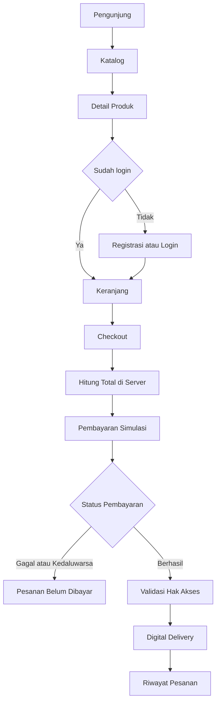
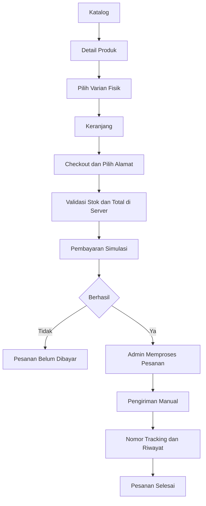

# Product Requirements Document

## InahuyShop | Product Digital E-Commerce

| Atribut | Nilai |
|---|---|
| Nama Produk | InahuyShop |
| Versi Dokumen | 2.0 |
| Status | Final Fixed |
| Jenis Produk | Single-store e-commerce berorientasi produk digital |
| Target Rilis | Q4 |
| Product Owner | Tim InahuyShop |
| Tech Lead | Mochammad Jihan Isfalana |
| Platform | Web, Android, dan iOS |
| Sumber Baseline | `README.md`, `docs/analisis.md`, `docs/PRD/PRDv1.md`, `docs/ERD/Online_Shop_Final_FIXED.erdplus`, dan `Architecture.md` |

## 1. Ringkasan Eksekutif

InahuyShop adalah platform e-commerce single-store yang berfokus pada penjualan produk digital berbentuk file unduhan, seperti e-book dan template. Produk dapat menyediakan varian fisik secara kondisional. Sistem harus memisahkan pemenuhan digital dan pengiriman fisik berdasarkan varian yang dibeli, termasuk ketika satu pesanan memuat kedua jenis varian.

Platform menyediakan pengalaman pelanggan melalui web dan aplikasi Android serta iOS. Pengelolaan toko tersedia melalui dashboard admin berbasis web dan aplikasi mobile. Seluruh kanal menggunakan backend/API terpusat agar autentikasi, otorisasi, harga, stok, status pesanan, pembayaran simulasi, penyerahan digital, dan pengiriman menerapkan aturan bisnis yang konsisten.

Versi ini menetapkan React, Vite, JavaScript, dan JSX untuk aplikasi web. React Compiler digunakan sesuai konfigurasi proyek. Database utama adalah MySQL. Teknologi backend dan framework mobile tetap tidak dikunci pada dokumen ini, tetapi keberadaan backend/API server-side terpisah merupakan ketentuan arsitektur.

Pembayaran pada cakupan ini bersifat simulasi dan tidak terhubung ke payment gateway produksi. Pengiriman fisik dikelola secara manual dengan dukungan nomor pelacakan. Aset digital harus dilindungi dan hanya dapat diakses oleh pelanggan yang memenuhi aturan pembayaran serta kepemilikan pesanan.

## 2. Konteks Produk

### 2.1 Latar Belakang

Pelanggan membutuhkan satu platform untuk menemukan produk, memilih varian, mengelola keranjang, melakukan checkout, menyelesaikan pembayaran simulasi, memperoleh akses file digital, dan memantau pengiriman jika membeli varian fisik. Admin membutuhkan kanal terpusat untuk mengelola katalog dan operasional toko dari desktop maupun perangkat mobile.

### 2.2 Masalah yang Diselesaikan

- Pelanggan memerlukan alur pembelian yang konsisten pada web dan aplikasi mobile.
- Sistem memerlukan pemisahan alur penyerahan file digital dan pengiriman barang fisik.
- Admin memerlukan kemampuan pengelolaan produk dan transaksi melalui dashboard web dan mobile.
- Harga, stok, voucher, total transaksi, dan izin akses harus dikendalikan oleh backend untuk menjaga integritas data.
- PRD, ERD, serta arsitektur perlu menjaga keterlacakan antara kebutuhan produk, implementasi, dan pengujian.

### 2.3 Visi Produk

Membangun platform e-commerce single-store yang aman, konsisten, mudah dipelihara, dan dapat diakses melalui web serta Android dan iOS dengan penggunaan ulang kode lintas aplikasi yang terukur.

## 3. Tujuan dan Hasil yang Diharapkan

### 3.1 Tujuan Produk

1. Menyediakan katalog produk digital dengan dukungan varian fisik secara kondisional.
2. Menyediakan registrasi, autentikasi, profil, alamat, keranjang, checkout, voucher, dan riwayat pesanan.
3. Menyediakan pembayaran simulasi dengan status dan referensi yang dapat ditelusuri.
4. Menyerahkan akses file digital hanya setelah pembayaran berhasil dan validasi kepemilikan dilakukan di server.
5. Mendukung pengiriman manual dan pelacakan untuk pesanan yang mengandung varian fisik.
6. Menyediakan dashboard admin melalui web dan aplikasi mobile.
7. Mempertahankan satu sumber aturan bisnis melalui backend/API terpusat.
8. Menjaga konsistensi kebutuhan produk terhadap ERD dan aturan integritas data.
9. Menjadikan aksesibilitas, keamanan dasar, dan responsivitas sebagai persyaratan penerimaan.

### 3.2 Indikator Keberhasilan

| Metrik | Target | Metode Pengukuran |
|---|---|---|
| Kelengkapan fitur prioritas P0 | 100 persen memenuhi acceptance criteria | Checklist pengujian fungsional |
| Keberhasilan checkout | Minimal 95 persen pada skenario normal | End-to-end test |
| Integritas transaksi | Tidak ada total tidak konsisten, stok negatif, atau order tanpa item dan pembayaran | Query pemeriksaan dan pengujian transaksi |
| Performa API baca sederhana | Maksimal 200 ms pada beban normal | Uji performa API |
| Waktu proses checkout | Maksimal 1 detik pada lingkungan pengujian normal | Uji performa checkout |
| Largest Contentful Paint web | Maksimal 2,5 detik sebagai target | Lighthouse dan pengujian browser |
| Aksesibilitas | Tidak ada pelanggaran serious atau critical pada halaman utama dan target Lighthouse Accessibility minimal 90 sebagai indikator | axe, Lighthouse, keyboard, dan pengujian manual |
| Keamanan dasar | Tidak ada temuan high severity terkait SQL injection, XSS, atau akses data lintas pelanggan | Pengujian keamanan dasar |
| Pemetaan model data | Seluruh 19 entitas ERD terhubung ke minimal satu kebutuhan fungsional | Matriks keterlacakan ERD ke FR |
| Kapasitas MVP | Target 100 pengguna aktif bersamaan | Uji beban pada lingkungan pengujian |
| Ketersediaan MVP | Best-effort minimal 99 persen tanpa SLA formal | Pemantauan ketersediaan saat operasional |

## 4. Pengguna dan Peran

### 4.1 Pengunjung

Pengunjung dapat melihat katalog, melakukan pencarian, menyaring kategori, dan membaca detail produk tanpa login. Pengunjung harus mendaftar atau login sebelum menggunakan fitur keranjang yang terikat akun dan menyelesaikan checkout.

### 4.2 Pelanggan

Pelanggan dapat mengelola profil dan buku alamat, memilih varian, mengelola keranjang, menggunakan voucher, melakukan checkout, menyelesaikan pembayaran simulasi, melihat riwayat pesanan, mengakses produk digital yang memenuhi syarat, memantau pengiriman fisik, dan mengirim ulasan yang memenuhi aturan.

Pelanggan mengakses layanan melalui web atau aplikasi Android dan iOS. Data akun, keranjang yang tersimpan, dan status pesanan harus konsisten lintas kanal melalui backend/API.

### 4.3 Admin Toko

Admin toko adalah operator single-store yang menggunakan entitas `seller` sesuai model data yang berlaku. Entitas tersebut bukan mekanisme marketplace multi-penjual.

Admin dapat mengelola kategori, produk, varian, gambar, voucher, pesanan, pembayaran simulasi, dan pengiriman fisik sesuai hak akses. Dashboard admin tersedia melalui website dan aplikasi mobile.

### 4.4 Prinsip Otorisasi

- Autentikasi pelanggan dan admin dipisahkan secara logis.
- Seluruh otorisasi wajib diperiksa oleh backend.
- Pelanggan hanya dapat mengakses data akun, alamat, pesanan, ulasan, dan aset digital yang menjadi haknya.
- Admin hanya dapat menjalankan fungsi administrasi setelah autentikasi berhasil.
- Validasi pada antarmuka tidak menggantikan validasi dan pemeriksaan izin di server.

## 5. Cakupan Produk

### 5.1 Termasuk dalam Cakupan

- Platform e-commerce single-store.
- Katalog publik dan detail produk.
- Produk utama berupa file unduhan.
- Varian fisik secara kondisional.
- Registrasi, login, logout, profil, dan buku alamat pelanggan.
- Keranjang dan checkout.
- Voucher dengan batas satu voucher per pesanan.
- Pembayaran simulasi.
- Riwayat dan detail pesanan.
- Penyerahan file digital dengan token akses terbatas.
- Pengiriman fisik manual dan pelacakan.
- Ulasan produk berdasarkan item pesanan yang sah.
- Storefront web berbasis React dan Vite.
- Aplikasi pelanggan untuk Android dan iOS.
- Dashboard admin pada web dan aplikasi mobile.
- Pemakaian ulang kode domain, API client, kontrak data, validasi, design tokens, dan UI lintas platform jika kompatibel.
- MySQL sebagai database utama.

### 5.2 Di Luar Cakupan

- Marketplace multi-penjual.
- Integrasi payment gateway produksi.
- Refund, retur, dan dispute.
- Guest checkout.
- Login sosial.
- Reset password melalui email.
- Integrasi otomatis dengan API kurir.
- Perhitungan ongkir real-time.
- Multi-currency.
- Loyalty program.
- Bundling produk dan subscription.
- Chat langsung dengan penjual.
- Notifikasi WhatsApp atau email.
- DRM tingkat lanjut.
- Fitur yang memerlukan integrasi pihak ketiga yang belum ditetapkan dalam baseline produk.

## 6. Platform dan Arsitektur Produk

### 6.1 Kanal Aplikasi

| Kanal | Platform dan Teknologi | Tanggung Jawab |
|---|---|---|
| Storefront web | React, Vite, JavaScript, JSX, dan React Compiler sesuai konfigurasi | Pengalaman belanja melalui browser |
| Admin web | React, Vite, JavaScript, JSX, dan React Compiler sesuai konfigurasi | Pengelolaan katalog dan operasional toko melalui browser |
| Aplikasi pelanggan | Android dan iOS | Pengalaman belanja pelanggan melalui perangkat mobile |
| Aplikasi admin | Android dan iOS | Pengelolaan operasional toko melalui perangkat mobile |
| Backend/API | Layanan server-side terpisah, framework dan bahasa belum dikunci | Autentikasi, otorisasi, aturan bisnis, transaksi, dan integrasi data |
| Database | MySQL InnoDB dengan `utf8mb4` | Penyimpanan data transaksi dan master |
| Penyimpanan aset digital | Penyedia dan infrastrukturnya belum dikunci | Penyimpanan file digital dengan akses terkontrol |
| Pembayaran | Simulasi internal | Pengujian alur dan status pembayaran tanpa gateway eksternal |

### 6.2 Arsitektur Konseptual

```text
Storefront Web       Customer Mobile
       │                    │
       └──────────┬─────────┘
                  │
             HTTPS / JSON
                  │
             Backend / API
                  │
       ┌──────────┴──────────┐
       │                     │
  MySQL Database      Protected Digital Storage
       │
       └──── Order, Payment, Delivery, Shipment

Admin Web           Admin Mobile
       │                    │
       └──────────┬─────────┘
                  │
             HTTPS / JSON
                  │
             Backend / API
```

### 6.3 Prinsip Arsitektur

1. Backend/API menjadi sumber utama aturan bisnis dan otorisasi.
2. Aplikasi klien tidak mengakses database secara langsung.
3. Seluruh kanal menggunakan kontrak API dan struktur data yang konsisten.
4. Domain logic tidak boleh diduplikasi tanpa alasan teknis yang jelas pada web, mobile, dan admin.
5. API client, kontrak data, validasi, dan design tokens dipertimbangkan sebagai paket bersama jika kompatibel.
6. Komponen UI web yang bergantung pada DOM tidak dianggap dapat digunakan langsung pada aplikasi native tanpa abstraksi atau adaptasi.
7. Penggunaan ulang UI lintas platform diprioritaskan jika mengurangi duplikasi tanpa meningkatkan kompleksitas dan tanpa menurunkan pengalaman pengguna.
8. React Compiler diterapkan sesuai konfigurasi proyek web. Tidak boleh terdapat konfigurasi compiler ganda yang saling bertentangan.
9. Struktur monorepo dapat digunakan untuk mengelola aplikasi dan paket bersama, tetapi pemilihan tooling monorepo serta package manager bukan persyaratan produk.
10. Framework aplikasi mobile, framework backend, package manager, hosting, domain, dan penyedia penyimpanan aset ditetapkan pada keputusan teknis implementasi tanpa mengubah kebutuhan produk dalam dokumen ini.

### 6.4 Batas Tanggung Jawab

| Komponen | Tanggung Jawab Utama |
|---|---|
| Storefront web | Penjelajahan katalog dan seluruh alur belanja pelanggan yang didukung web |
| Customer mobile | Alur belanja pelanggan untuk Android dan iOS |
| Admin web | Pengelolaan lengkap modul administrasi toko |
| Admin mobile | Pengelolaan operasional toko melalui Android dan iOS |
| Backend/API | Validasi bisnis, autentikasi, otorisasi, transaksi, status, dan pembatasan akses |
| Database | Integritas, persistensi, relasi, dan konsistensi data |
| Digital storage | Penyimpanan dan penyajian aset digital melalui mekanisme akses terkontrol |

## 7. User Story

| ID | User Story | Kebutuhan |
|---|---|---|
| US-01 | Sebagai pengunjung, saya ingin mendaftar menggunakan data akun yang diperlukan agar dapat berbelanja | FR-01 |
| US-02 | Sebagai pelanggan, saya ingin login dan logout dengan aman | FR-02 |
| US-03 | Sebagai pelanggan, saya ingin mengelola profil dan alamat | FR-03 |
| US-04 | Sebagai pengunjung, saya ingin mencari dan menyaring katalog | FR-07 |
| US-05 | Sebagai pelanggan, saya ingin melihat detail produk, varian, harga, gambar, ketersediaan, dan ulasan | FR-07 |
| US-06 | Sebagai pelanggan, saya ingin memasukkan varian ke keranjang dan mengubah jumlahnya | FR-09 |
| US-07 | Sebagai pelanggan, saya ingin menggunakan voucher yang valid pada checkout | FR-10, FR-11 |
| US-08 | Sebagai pelanggan, saya ingin menyelesaikan pembayaran simulasi | FR-12 |
| US-09 | Sebagai pelanggan, saya ingin mengakses file digital setelah pembayaran berhasil | FR-18 |
| US-10 | Sebagai pelanggan, saya ingin melihat riwayat dan status pesanan | FR-13 |
| US-11 | Sebagai pelanggan, saya ingin mengulas produk yang telah dibeli sesuai aturan | FR-16 |
| US-12 | Sebagai admin, saya ingin login ke dashboard administrasi | FR-04 |
| US-13 | Sebagai admin, saya ingin mengelola kategori, produk, varian, dan gambar | FR-05, FR-06, FR-08 |
| US-14 | Sebagai admin, saya ingin mengelola voucher | FR-17 |
| US-15 | Sebagai admin, saya ingin memantau dan memperbarui pesanan serta status operasionalnya | FR-14 |
| US-16 | Sebagai admin, saya ingin mengelola pengiriman dan pelacakan pesanan fisik | FR-15 |
| US-17 | Sebagai pelanggan, saya ingin menggunakan alur belanja utama melalui aplikasi Android dan iOS | FR-19 |
| US-18 | Sebagai admin, saya ingin mengakses fungsi administrasi melalui aplikasi mobile | FR-20 |
| US-19 | Sebagai pengguna, saya ingin perubahan data tersimpan konsisten ketika berpindah kanal | FR-21 |

## 8. Persyaratan Fungsional

Prioritas P0 menunjukkan fitur wajib untuk MVP. Prioritas P1 menunjukkan fitur penting yang dapat diselesaikan setelah seluruh kebutuhan P0 memenuhi acceptance criteria. Persyaratan kondisional hanya berlaku jika jenis varian atau transaksi terkait digunakan.

### 8.1 Akun dan Autentikasi

| ID | Fitur | Prioritas | Entitas | Acceptance Criteria |
|---|---|---|---|---|
| FR-01 | Registrasi pelanggan | P0 | `customers` | Form menerima nama, email, telepon, password, dan `birth_date`. Email dan telepon unik. Password disimpan sebagai hash. `created_at` diisi otomatis. `is_active` aktif secara default. Nilai `age` dihitung dari `birth_date` dan tidak disimpan sebagai atribut mandiri. |
| FR-02 | Login dan logout pelanggan | P0 | `customers` | Login menggunakan email dan password. Akun nonaktif ditolak. Pesan gagal tidak membocorkan keberadaan email. Logout mengakhiri sesi. Rate limiting diterapkan. |
| FR-03 | Profil dan buku alamat | P1 | `customers`, `customer_address` | Pelanggan dapat membuat, membaca, memperbarui, dan menghapus alamatnya. Maksimal satu alamat menjadi default. Alamat wajib dipilih pada checkout yang mengandung varian fisik. |
| FR-04 | Login admin | P0 | `seller` | Autentikasi admin terpisah secara logis dari pelanggan. Panel admin hanya dapat dibuka setelah login berhasil. Akun admin awal dibuat melalui seeding atau mekanisme administrasi yang terkendali. |

### 8.2 Katalog, Produk, dan Varian

| ID | Fitur | Prioritas | Entitas | Acceptance Criteria |
|---|---|---|---|---|
| FR-05 | Pengelolaan kategori | P1 | `categories` | Admin dapat mengelola kategori. `slug` unik. `parent_id` bersifat opsional. Sistem mencegah siklus kategori. Kategori yang masih dipakai tidak dapat dihapus dengan cara yang merusak relasi. |
| FR-06 | Pengelolaan produk, varian, dan gambar | P0 | `products`, `product_variant`, `product_image` | Admin dapat mengelola produk, varian, dan gambar. Setiap produk memiliki minimal satu varian. Varian menggunakan `delivery_type` bernilai `digital` atau `physical`. Varian memiliki SKU dan harga. Stok dan berat digunakan sesuai aturan varian. Gambar menyimpan `url`, `alt_text`, dan `sort_order`. |
| FR-07 | Katalog dan detail produk | P0 | `products`, `categories`, `product_variant`, `product_image`, `reviews` | Hanya produk aktif ditampilkan. Katalog mendukung pagination, filter kategori, dan pencarian nama atau brand. Detail menampilkan informasi produk, varian, harga, ketersediaan, gambar, rating, dan ulasan. |
| FR-08 | Ketersediaan stok varian | P0 | `product_variant` | `stock_qty` tidak boleh negatif. Pengurangan stok fisik dilakukan secara atomik. Stok digital tidak diperlakukan sebagai stok barang fisik. Ketersediaan aset digital tetap divalidasi. Semua keputusan stok divalidasi oleh server. |

### 8.3 Keranjang, Checkout, Voucher, dan Pembayaran

| ID | Fitur | Prioritas | Entitas | Acceptance Criteria |
|---|---|---|---|---|
| FR-09 | Keranjang belanja | P0 | `carts`, `cart_item` | Satu keranjang tersimpan untuk setiap pelanggan. Varian yang sama tidak menghasilkan item duplikat dalam keranjang yang sama. Jumlah minimal satu. Perubahan keranjang tersimpan antar sesi dan konsisten lintas kanal. Pesan perubahan yang relevan dapat diumumkan ke teknologi bantu. |
| FR-10 | Checkout dan pembuatan pesanan | P0 | `orders`, `order_item`, `customer_address` | Pesanan dibuat berdasarkan keranjang yang tervalidasi. `order_number` unik. `product_name_snapshot` dan `unit_price` disimpan. `line_total`, `subtotal`, `discount_amount`, `shipping_cost`, dan `grand_total` dihitung di server. Pembuatan order, item, pembaruan stok, dan pembersihan keranjang berada dalam satu transaksi database. `shipping_address_id` hanya diisi jika pesanan mengandung varian fisik. `shipping_cost` bernilai nol untuk pesanan digital murni sesuai baseline. |
| FR-11 | Voucher saat checkout | P1 | `vouchers`, `order_vouchers` | Kode divalidasi berdasarkan masa berlaku, minimum belanja, status penggunaan, dan usage limit. Diskon dicatat pada transaksi. `grand_total` tidak boleh negatif. Maksimal satu voucher dapat diterapkan pada satu pesanan. |
| FR-12 | Pembayaran simulasi | P0 | `payments` | Setiap order memiliki record pembayaran. `method` bernilai `simulation`. `amount` sama dengan `grand_total`. Status awal `pending`. Sistem dapat mensimulasikan status `success`, `failed`, atau `expired`. `payment_reference` digunakan sebagai referensi simulasi. Tidak ada callback gateway eksternal. |

### 8.4 Pesanan, Pengiriman, Penyerahan Digital, dan Ulasan

| ID | Fitur | Prioritas | Entitas | Acceptance Criteria |
|---|---|---|---|---|
| FR-13 | Riwayat dan detail pesanan | P0 | `orders`, `order_item`, `payments`, `digital_delivery`, `shipments` | Pelanggan hanya melihat pesanannya sendiri. Detail menampilkan snapshot item, diskon, total, pembayaran, status penyerahan digital, dan pengiriman apabila relevan. |
| FR-14 | Pengelolaan pesanan dan pembayaran | P0 | `orders`, `order_item`, `payments` | Admin dapat mencari dan menyaring pesanan. Perubahan status mengikuti alur status final. Pembaruan tidak boleh menghasilkan pesanan tanpa item atau record pembayaran. Setiap aksi dibatasi sesuai hak akses. |
| FR-15 | Pengiriman dan pelacakan fisik | P1 kondisional | `shipments`, `shipment_track`, `customer_address` | Hanya digunakan jika order mengandung varian `physical`. Admin dapat mengisi kurir, layanan, nomor tracking, dan tanggal kirim. Pelanggan dapat melihat status dan riwayat tracking. Integrasi otomatis kurir tidak termasuk cakupan. |
| FR-16 | Ulasan produk | P1 | `reviews`, `order_item` | Ulasan hanya dapat dibuat oleh pelanggan yang memiliki `order_item` yang sah dan pesanan telah dibayar atau selesai sesuai aturan produk. Satu `order_item` maksimal memiliki satu ulasan. `rating` berada pada rentang 1 sampai 5. `customer_id` dan `product_id` tidak disimpan di `reviews` karena diturunkan dari `order_item`. |
| FR-17 | Pengelolaan voucher | P1 | `vouchers` | Admin dapat membuat, membaca, memperbarui, dan menonaktifkan voucher. Voucher yang pernah digunakan tidak dihapus secara fisik jika penghapusan mengganggu histori transaksi. |
| FR-18 | Penyerahan produk digital | P0 | `digital_asset`, `digital_delivery`, `order_item`, `product_variant` | Setelah pembayaran sukses, aset digital yang termasuk dalam item pesanan dapat diakses pelanggan yang berhak. `download_token` unik dan dibatasi. `expires_at` dan `download_count` dicatat. Pemilik pesanan diverifikasi di server pada setiap akses. URL publik permanen tanpa pemeriksaan hak akses tidak boleh menjadi satu-satunya mekanisme perlindungan. |

### 8.5 Aplikasi Mobile dan Konsistensi Lintas Kanal

| ID | Fitur | Prioritas | Platform | Acceptance Criteria |
|---|---|---|---|---|
| FR-19 | Aplikasi pelanggan mobile | P0 | Android dan iOS | Aplikasi mendukung katalog, detail produk, akun, profil, alamat, keranjang, checkout, pembayaran simulasi, riwayat pesanan, akses digital yang sah, pelacakan pengiriman, dan ulasan sesuai hak pengguna. Data disimpan melalui backend/API yang sama dengan web. |
| FR-20 | Dashboard admin mobile | P0 | Android dan iOS | Admin dapat login dan mengakses operasional toko melalui aplikasi mobile. Fitur minimum mencakup ringkasan operasional, kategori, produk dan varian, voucher, pesanan, pembayaran simulasi, serta pengiriman fisik. Akses dan perubahan data mengikuti izin yang sama dengan admin web. |
| FR-21 | Konsistensi lintas kanal | P0 | Web, Android, dan iOS | Data akun, katalog, keranjang tersimpan, voucher, pesanan, pembayaran, penyerahan digital, serta pengiriman bersumber dari backend/API yang sama. Perubahan yang berhasil pada satu kanal terlihat pada kanal lain setelah data disinkronkan melalui API. Tidak ada aturan bisnis penting yang hanya diterapkan di antarmuka klien. |

## 9. Aturan Bisnis

| ID | Aturan |
|---|---|
| BR-01 | InahuyShop beroperasi sebagai toko tunggal. Model ini bukan marketplace multi-penjual. |
| BR-02 | Produk utama berupa file unduhan. Produk dapat menyediakan varian fisik secara kondisional. |
| BR-03 | Setiap produk memiliki minimal satu varian. `product_variant.delivery_type` menentukan alur `digital` atau `physical`. |
| BR-04 | Stok fisik digunakan untuk mengendalikan ketersediaan barang. Aset digital diperiksa berdasarkan ketersediaan file dan hak penyerahan, bukan diproses seperti stok barang fisik. |
| BR-05 | Satu pesanan dapat memuat varian digital dan fisik. Setiap item tetap menyimpan snapshot nama produk dan harga satuan pada saat transaksi. |
| BR-06 | Alamat pengiriman dan proses shipment hanya diwajibkan jika pesanan mengandung setidaknya satu varian fisik. |
| BR-07 | Harga, diskon, subtotal, ongkir, dan total akhir dihitung di server menggunakan data yang tervalidasi. |
| BR-08 | Pembuatan pesanan, item pesanan, pembaruan stok, dan perubahan keranjang harus menjaga integritas melalui transaksi database. |
| BR-09 | Satu pesanan dapat menggunakan maksimal satu voucher. Total transaksi tidak boleh negatif. |
| BR-10 | Pembayaran menggunakan metode `simulation` tanpa integrasi payment gateway atau callback eksternal. |
| BR-11 | Akses digital baru diberikan setelah pembayaran berstatus `success` dan kepemilikan pesanan telah diverifikasi. |
| BR-12 | Token unduhan harus unik serta dapat dibatasi berdasarkan masa berlaku dan jumlah unduhan. |
| BR-13 | Pelanggan hanya dapat membaca atau mengubah data yang menjadi haknya. Pemeriksaan izin dilakukan pada backend untuk semua kanal. |
| BR-14 | Ulasan terkait dengan `order_item`. `customer_id` dan `product_id` tidak disimpan ulang di tabel `reviews`. |
| BR-15 | Data historis transaksi tidak boleh rusak akibat penghapusan kategori, produk, voucher, atau data yang telah direferensikan oleh transaksi. |
| BR-16 | Entitas `seller` merepresentasikan akun admin toko sesuai model single-store dan tidak digunakan untuk membentuk relasi multi-penjual. |

## 10. Alur Pengguna Utama

### 10.1 Pembelian Produk Digital



### 10.2 Pembelian Varian Fisik



### 10.3 Pembelian Campuran

Pesanan campuran mengikuti satu checkout dan satu alur pembayaran simulasi. Setelah pembayaran berhasil, sistem menyiapkan penyerahan digital untuk item digital dan membuat alur pengiriman untuk item fisik. Akses digital tidak menunggu pengiriman fisik apabila syarat pembayaran dan kepemilikan sudah terpenuhi.

## 11. Inventaris Halaman dan Layar

### 11.1 Storefront Web dan Aplikasi Pelanggan

| Kode | Halaman atau Layar | Peran | FR Utama |
|---|---|---|---|
| C-01 | Beranda dan katalog | Publik | FR-07 |
| C-02 | Pencarian dan filter kategori | Publik | FR-07 |
| C-03 | Detail produk dan pilihan varian | Publik | FR-06, FR-07 |
| C-04 | Registrasi | Publik | FR-01 |
| C-05 | Login | Publik | FR-02 |
| C-06 | Keranjang | Pelanggan | FR-09 |
| C-07 | Checkout dan alamat | Pelanggan | FR-03, FR-10, FR-11 |
| C-08 | Pembayaran simulasi | Pelanggan | FR-12 |
| C-09 | Riwayat pesanan | Pelanggan | FR-13 |
| C-10 | Detail pesanan, digital delivery, dan tracking | Pelanggan | FR-13, FR-15, FR-18 |
| C-11 | Profil dan buku alamat | Pelanggan | FR-03 |
| C-12 | Ulasan produk | Pelanggan | FR-16 |

### 11.2 Dashboard Admin Web dan Aplikasi Admin

| Kode | Halaman atau Layar | Peran | FR Utama |
|---|---|---|---|
| A-01 | Login admin | Admin | FR-04 |
| A-02 | Ringkasan operasional | Admin | FR-14, FR-20 |
| A-03 | Pengelolaan kategori | Admin | FR-05 |
| A-04 | Pengelolaan produk, varian, dan gambar | Admin | FR-06, FR-08 |
| A-05 | Pengelolaan voucher | Admin | FR-17 |
| A-06 | Daftar dan pencarian pesanan | Admin | FR-14 |
| A-07 | Detail pesanan dan pembayaran | Admin | FR-12, FR-14 |
| A-08 | Pengiriman dan tracking | Admin | FR-15 |

## 12. Persyaratan Non-Fungsional

### 12.1 Performa

- API baca sederhana memiliki target waktu respons maksimal 200 ms pada beban normal.
- Checkout memiliki target waktu proses maksimal 1 detik pada lingkungan pengujian normal.
- Halaman katalog web memiliki target Largest Contentful Paint maksimal 2,5 detik.
- Query pencarian dan foreign key utama menggunakan indeks yang sesuai.
- Pagination digunakan pada daftar yang berpotensi besar.
- Performa aplikasi mobile diukur pada perangkat dan kondisi pengujian yang representatif sebelum rilis.

### 12.2 Keamanan

- Password disimpan menggunakan hash satu arah yang kuat seperti bcrypt atau Argon2id, bukan plaintext.
- HTTPS digunakan untuk pertukaran data melalui jaringan.
- Query database menggunakan parameterized query atau mekanisme setara yang aman.
- Output teks dikodekan dengan benar untuk mencegah XSS.
- Otorisasi dan validasi aturan bisnis dilakukan di server.
- Cookie sesi menggunakan `HttpOnly`, `Secure`, dan `SameSite` jika mekanisme sesi berbasis cookie digunakan.
- Rate limiting diterapkan pada autentikasi dan endpoint sensitif.
- Token digital memiliki masa berlaku dan pembatasan akses sesuai kebijakan sistem.
- Harga, diskon, stok, dan total dihitung atau divalidasi di server, bukan dipercaya dari input klien.
- Aset digital tidak boleh dapat diakses hanya berdasarkan URL publik permanen tanpa pemeriksaan hak akses.
- Kredensial dan secret tidak disimpan di repository atau kode aplikasi.

### 12.3 Privasi dan Pengelolaan Data

- Data pribadi dikumpulkan dan diproses sesuai kebutuhan alur produk.
- Akses terhadap data pelanggan dibatasi berdasarkan peran dan kepemilikan.
- Informasi pribadi tidak boleh ditampilkan dalam pesan error atau log yang tidak memerlukan data tersebut.
- Pengelolaan data pribadi mengacu pada UU No. 27 Tahun 2022 tentang Pelindungan Data Pribadi.

### 12.4 Skalabilitas dan Ketersediaan

- Target MVP adalah 100 pengguna aktif bersamaan.
- Target ketersediaan MVP adalah best-effort minimal 99 persen tanpa SLA formal.
- Query utama menggunakan indeks dan pagination yang sesuai.
- Penggunaan backend/API terpusat mencegah aturan bisnis yang berbeda antar aplikasi klien.

### 12.5 Aksesibilitas dan Usability

Target aksesibilitas antarmuka adalah WCAG 2.1 Level AA dengan penerapan yang relevan terhadap jenis platform.

- Gambar informatif memiliki teks alternatif yang sesuai.
- Struktur halaman, label, dan kontrol bersifat semantik.
- Kontras teks memenuhi kriteria minimum.
- Konten web dapat diubah ukurannya dan menyesuaikan lebar layar.
- Alur web dapat digunakan dengan keyboard dan menampilkan fokus yang terlihat.
- Form menampilkan identifikasi error dan petunjuk koreksi yang jelas.
- Komponen memiliki nama, peran, nilai, dan status yang dapat dikenali teknologi bantu.
- Aplikasi mobile mendukung pembaca layar, label kontrol, fokus yang masuk akal, dan area interaksi yang dapat digunakan.
- Penggunaan Bootstrap atau komponen pihak ketiga tidak dianggap sebagai bukti kepatuhan otomatis.

### 12.6 Integritas dan Kompatibilitas Data

- Database menggunakan MySQL InnoDB dan charset `utf8mb4`.
- Nilai uang menggunakan tipe numerik presisi seperti `DECIMAL`.
- Mata uang sistem adalah IDR.
- Bahasa antarmuka utama adalah Bahasa Indonesia.
- Timestamp diterapkan secara konsisten.
- Foreign key dan aturan penghapusan harus menjaga histori transaksi.
- Kolom status menggunakan nilai yang didefinisikan dalam dokumen ini.
- Target browser web adalah browser modern yang mendukung kebutuhan React dan Vite.
- Target aplikasi mobile adalah Android dan iOS. Versi OS minimum ditetapkan pada perencanaan rilis teknis.

### 12.7 Maintainability dan Reuse

- Kode dipisahkan berdasarkan tanggung jawab dan domain.
- Komponen umum, domain logic, API client, kontrak data, validasi, dan design tokens dibagikan jika kompatibel dengan platform pemakai.
- Komponen UI tidak dipaksakan untuk digunakan bersama jika menghasilkan kompleksitas atau perilaku aksesibilitas yang lebih buruk.
- Penamaan modul, kontrak API, status, dan aturan bisnis harus konsisten pada semua kanal.
- Perubahan yang memengaruhi PRD, ERD, kontrak API, atau alur transaksi harus tercermin pada dokumentasi terkait.

## 13. Model Data dan Integritas ERD

ERD final menjadi sumber rujukan struktur data dengan 19 entitas. Penambahan atau perubahan entitas, atribut, foreign key, atau aturan relasi harus diselaraskan dengan ERD sebelum implementasi dianggap final.

### 13.1 Entitas dan Kebutuhan Terkait

| No. | Entitas | Kebutuhan Utama |
|---|---|---|
| 1 | `customers` | FR-01, FR-02, FR-03 |
| 2 | `customer_address` | FR-03, FR-10, FR-15 |
| 3 | `seller` | FR-04 |
| 4 | `categories` | FR-05, FR-07 |
| 5 | `products` | FR-06, FR-07 |
| 6 | `product_variant` | FR-06, FR-07, FR-08, FR-09, FR-18 |
| 7 | `product_image` | FR-06, FR-07 |
| 8 | `carts` | FR-09 |
| 9 | `cart_item` | FR-09 |
| 10 | `orders` | FR-10, FR-13, FR-14 |
| 11 | `order_item` | FR-10, FR-13, FR-16, FR-18 |
| 12 | `payments` | FR-12, FR-13, FR-14 |
| 13 | `vouchers` | FR-11, FR-17 |
| 14 | `order_vouchers` | FR-11 |
| 15 | `shipments` | FR-15 |
| 16 | `shipment_track` | FR-15 |
| 17 | `reviews` | FR-07, FR-16 |
| 18 | `digital_asset` | FR-18 |
| 19 | `digital_delivery` | FR-13, FR-18 |

### 13.2 Aturan Atribut Turunan dan Snapshot

| Entitas | Atribut | Klasifikasi | Aturan |
|---|---|---|---|
| `customers` | `age` | Turunan | Dihitung dari `birth_date` dan tidak disimpan |
| `orders` | `subtotal` | Turunan tersimpan | Jumlah `order_item.line_total` yang dihitung di server dan disimpan sebagai snapshot transaksi |
| `orders` | `grand_total` | Turunan tersimpan | `subtotal - discount_amount + shipping_cost` yang dihitung di server dan disimpan |
| `order_item` | `line_total` | Turunan tersimpan | `unit_price × quantity` yang dihitung di server dan disimpan |
| `reviews` | `customer_id`, `product_id` | Tidak disimpan | Diturunkan melalui `order_item`, `orders`, `product_variant`, dan `products` |

### 13.3 Ketentuan Integritas

- Relasi `orders` ke `customer_address` dan `order_item` ke `product_variant` harus sesuai ERD final.
- Kunci komposit yang telah ditetapkan pada `cart_item` dan `order_vouchers` tetap dipertahankan.
- Data histori transaksi dipertahankan ketika data master yang direferensikan tidak lagi aktif.
- Aturan status pesanan dan pembayaran mengikuti bagian status final dalam PRD ini.
- Status aktif voucher dapat ditentukan dari kondisi dan masa berlaku tanpa menambahkan entitas baru.
- Audit trail perubahan status bukan bagian dari baseline saat ini.

## 14. Status dan Transisi

### 14.1 Status Pesanan

| Field | Nilai | Aturan |
|---|---|---|
| `orders.status` | `pending_payment` | Pesanan menunggu pembayaran simulasi |
| `orders.status` | `paid` | Pembayaran berhasil |
| `orders.status` | `processing` | Pesanan fisik sedang diproses |
| `orders.status` | `shipped` | Pesanan fisik telah dikirim |
| `orders.status` | `completed` | Pesanan telah selesai. Order digital dapat selesai setelah akses digital disiapkan sesuai aturan |
| `orders.status` | `cancelled` | Pesanan dibatalkan sesuai aturan sistem |
| `orders.status` | `expired` | Pesanan kedaluwarsa sesuai kebijakan pembayaran simulasi |

`processing` dan `shipped` hanya relevan untuk pesanan yang mengandung varian fisik. Transisi status dikontrol backend dan tidak dapat dipilih bebas dari antarmuka klien.

### 14.2 Status Pembayaran

| Field | Nilai | Aturan |
|---|---|---|
| `payments.status` | `pending` | Pembayaran belum diselesaikan |
| `payments.status` | `success` | Pembayaran simulasi berhasil |
| `payments.status` | `failed` | Pembayaran simulasi gagal |
| `payments.status` | `expired` | Pembayaran simulasi kedaluwarsa |
| `payments.method` | `simulation` | Metode pembayaran yang digunakan pada baseline |

Status `refunded` tidak digunakan pada cakupan saat ini.

### 14.3 Status Tracking Pengiriman

| Field | Nilai | Aturan |
|---|---|---|
| `shipment_track.status` | `picked_up` | Paket telah diterima kurir |
| `shipment_track.status` | `in_transit` | Paket sedang dalam perjalanan |
| `shipment_track.status` | `out_for_delivery` | Paket sedang diantar ke penerima |
| `shipment_track.status` | `delivered` | Paket telah diterima |

Status tracking hanya digunakan untuk pesanan fisik. Nilai status dan urutan transisinya divalidasi oleh backend.

### 14.4 Status dan Tipe Voucher serta Varian

| Field | Nilai | Aturan |
|---|---|---|
| `vouchers.discount_type` | `percentage` | Diskon berbentuk persentase |
| `vouchers.discount_type` | `fixed` | Diskon berbentuk nilai tetap |
| `product_variant.delivery_type` | `digital` | Varian diserahkan melalui aset digital |
| `product_variant.delivery_type` | `physical` | Varian memerlukan pemenuhan fisik dan pengiriman |

## 15. Pengujian dan Kriteria Penerimaan

### 15.1 Pengujian Fungsional

- Seluruh acceptance criteria P0 lulus sebelum rilis MVP.
- Pengujian dilakukan untuk web, Android, dan iOS pada alur pelanggan yang didukung.
- Pengujian admin mencakup web dan aplikasi mobile.
- Pengujian mencakup alur digital, fisik, dan campuran.
- Pengujian mencakup skenario pembayaran `success`, `failed`, dan `expired`.
- Pengujian akses digital memastikan pengguna yang tidak memiliki hak tidak dapat memperoleh file.
- Pengujian otorisasi memastikan pelanggan tidak dapat membaca data milik pelanggan lain.

### 15.2 Pengujian Integritas Data

- Tidak ada `grand_total` yang tidak konsisten dengan nilai transaksi.
- Tidak ada stok fisik negatif.
- Tidak ada pesanan tanpa item atau record pembayaran.
- Tidak ada pengiriman pada pesanan digital murni.
- Tidak ada akses digital sebelum pembayaran berhasil.
- Tidak ada lebih dari satu voucher pada satu pesanan.
- Tidak ada ulasan ganda pada `order_item` yang sama.
- Kunci dan foreign key mengikuti ERD final.

### 15.3 Pengujian Platform

- Layout web responsif pada viewport desktop dan mobile.
- Alur aplikasi pelanggan berjalan pada Android dan iOS.
- Alur administrasi utama dapat digunakan melalui admin web dan admin mobile.
- Data yang diubah melalui satu kanal terlihat konsisten melalui kanal lain setelah sinkronisasi API.
- Komponen interaktif dan form diuji menggunakan keyboard atau teknologi bantu yang sesuai dengan platform.

### 15.4 Definisi Selesai

Sebuah fitur dinyatakan selesai apabila acceptance criteria terpenuhi, validasi dan otorisasi sisi server berjalan, data konsisten dengan ERD, pengujian yang relevan lulus, dan dokumentasi terkait telah diperbarui apabila terdapat perubahan kontrak atau aturan bisnis.

## 16. Risiko dan Mitigasi

| Risiko | Dampak | Mitigasi |
|---|---|---|
| Alur digital dan fisik tercampur | Tinggi | Gunakan `product_variant.delivery_type` dan kondisi checkout yang eksplisit |
| Aset digital tidak terlindungi | Tinggi | Gunakan token unik, masa berlaku, pemeriksaan kepemilikan, dan kontrol akses server |
| Harga atau total dimanipulasi klien | Tinggi | Hitung total transaksi di server dalam transaksi database |
| Race condition stok atau voucher | Sedang hingga tinggi | Gunakan transaksi, pembaruan atomik, atau penguncian baris sesuai implementasi backend |
| Status berbeda antar kanal | Tinggi | Jadikan backend/API sumber status yang otoritatif |
| Reuse UI lintas platform menambah kompleksitas | Sedang | Terapkan reuse hanya saat kompatibilitas dan manfaat teknis terbukti |
| Teknologi backend atau mobile belum dikunci | Sedang | Pertahankan kontrak API dan aturan bisnis independen dari framework klien |
| Akses admin dari perangkat mobile tidak aman | Tinggi | Gunakan autentikasi, otorisasi server, dan kontrol sesi yang sama ketatnya dengan admin web |
| Riwayat transaksi rusak karena penghapusan data master | Tinggi | Terapkan aturan foreign key dan kebijakan penghapusan yang menjaga histori |
| Aksesibilitas tidak konsisten antar platform | Sedang | Terapkan acceptance baseline WCAG 2.1 AA dan lakukan pengujian manual serta otomatis |
| Pembayaran simulasi disalahartikan sebagai gateway produksi | Sedang | Tampilkan bahwa pembayaran merupakan simulasi dan tidak memakai gateway eksternal |

## 17. Keputusan Baseline Final

| ID | Keputusan | Status |
|---|---|---|
| D-01 | Produk utama dijual sebagai file unduhan seperti e-book dan template | Final |
| D-02 | Pengiriman fisik digunakan jika pelanggan memilih varian fisik | Final |
| D-03 | `digital_asset` dan `digital_delivery` digunakan untuk aset serta penyerahan digital | Final |
| D-04 | Backend/API server-side wajib tersedia dan framework atau bahasa implementasinya belum dikunci | Final |
| D-05 | Pembayaran menggunakan simulasi dan bukan payment gateway produksi | Final |
| D-06 | `line_total`, `subtotal`, dan `grand_total` dihitung di server dan disimpan sebagai nilai transaksi | Final |
| D-07 | Produk beroperasi sebagai toko tunggal atau single-store | Final |
| D-08 | `reviews.customer_id` dan `reviews.product_id` diturunkan dari `order_item` dan tidak disimpan sebagai atribut terpisah | Final |
| D-09 | Nilai status transaksi mengikuti bagian status final dalam dokumen ini | Final |
| D-10 | Target performa, kapasitas MVP, ketersediaan, dan metrik keberhasilan ditetapkan dalam dokumen ini | Final |
| D-11 | Aksesibilitas menggunakan WCAG 2.1 Level AA sebagai baseline | Final |
| D-12 | Platform pelanggan mencakup web, Android, dan iOS | Final |
| D-13 | Dashboard admin tersedia pada website serta aplikasi mobile Android dan iOS | Final |
| D-14 | Penggunaan ulang kode diprioritaskan termasuk abstraksi UI lintas platform jika kompatibel secara teknis | Final |
| D-15 | Frontend web menggunakan React, Vite, JavaScript, dan JSX dengan React Compiler sesuai konfigurasi proyek | Final |
| D-16 | MySQL adalah database utama | Final |
| D-17 | Seluruh kanal menggunakan backend/API terpusat untuk aturan bisnis dan persistensi data | Final |

## 18. Referensi Internal

- `README.md`
- `docs/analisis.md`
- `docs/PRD/PRDv1.md`
- `docs/ERD/Online_Shop_Final_FIXED.erdplus`
- `Architecture.md`
